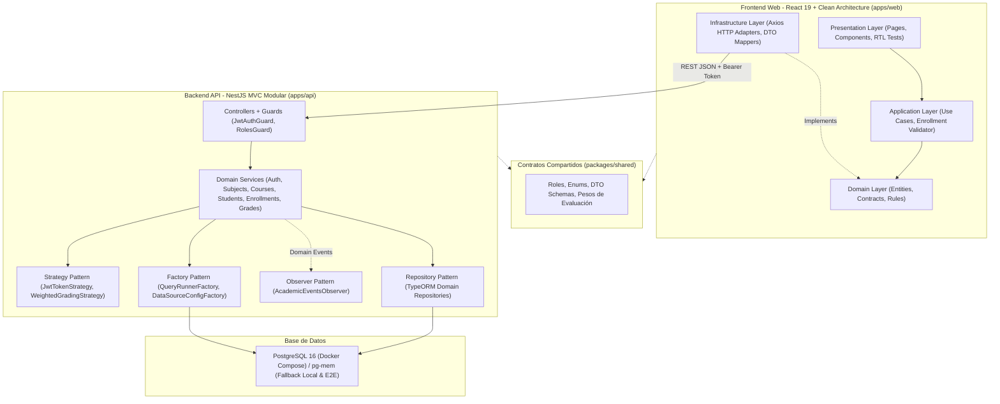

# Sistema Académico Institucional UNICEN 2026

Sistema académico integral desarrollado como solución técnica de alto rendimiento para la **Universidad Central (UNICEN)**. El proyecto implementa un monorepo modular con backend en **NestJS**, frontend en **React 19** con Clean Architecture, base de datos en **PostgreSQL**, contenedorización completa en **Docker Compose** y un sistema de diseño institucional propio denominado **Academic Precision**.

---

## 📌 Tabla de Contenidos

- [Módulos y Funcionalidades del Sistema](#-módulos-y-funcionalidades-del-sistema)
- [Decisiones de Arquitectura y Patrones de Diseño](#-decisiones-de-arquitectura-y-justificación-de-patrones)
- [Diagrama de Arquitectura](#-diagrama-de-arquitectura)
- [Credenciales Semilla de Evaluación](#-credenciales-semilla-de-evaluación)
- [Despliegue Rápido con Docker Compose](#-despliegue-con-docker-compose)
- [Entorno de Desarrollo Local](#-entorno-de-desarrollo-local)
- [Batería de Pruebas Automatizadas](#-batería-de-pruebas-automatizadas)
- [Sistema de Diseño e Identidad Visual](#-sistema-de-diseño-e-identidad-visual-academic-precision)

---

## 🎯 Módulos y Funcionalidades del Sistema

El sistema cubre integralmente los flujos académicos institucionales respetando el control de acceso basado en roles (**RBAC: Admin, Docente, Estudiante**):

### 1. Autenticación y Control de Acceso (RBAC)
- Autenticación mediante **JWT** con firma criptográfica y expiración configurable.
- Guards de autorización granular (`JwtAuthGuard`, `RolesGuard`) que protegen endpoints según el perfil del usuario.
- Interfaz de inicio de sesión con **acceso rápido de un clic** por rol, facilitando pruebas inmediatas durante revisiones técnicas sin necesidad de tipear credenciales manualmente.

### 2. Gestión de Estudiantes y Expediente Académico
- Registro de alumnos con generación automática de **Registro Universitario (RU)** con formato `RU-YYYY-XXXXX`.
- Historial académico consolidado: asignaturas cursadas, estado de aprobación, promedio ponderado acumulado y créditos completados.
- Métricas en tiempo real en la ficha del estudiante.

### 3. Asignaturas, Paralelos y Oferta Académica
- Creación y administración de asignaturas (código, nombre, créditos, semestre y prerrequisitos).
- Apertura de cursos/paralelos definiendo cupo máximo, horario y docente titular asignado.
- Indicador visual dinámico de ocupación de cupos con alertas de saturación y capacidad crítica.

### 4. Motor Transaccional de Inscripciones
- Inscripción de estudiantes a cursos garantizando consistencia ACID.
- **Validaciones multinivel:**
  - Prevención de duplicidad (un alumno no puede cursar el mismo paralelo dos veces en el período).
  - Verificación estricta de cupos disponibles en tiempo real.
  - Detección de solapamiento/choque de horarios entre asignaturas seleccionadas.
- Cancelación o retiro de inscripción con liberación inmediata de cupo para otros postulantes.

### 5. Libro de Calificaciones y Acta de Notas
- Evaluación multidimensional con ponderación oficial UNICEN sobre **100 puntos**:
  - **Primer Parcial (1P):** 25%
  - **Segundo Parcial (2P):** 25%
  - **Evaluación Continua / Prácticas (EC):** 20%
  - **Examen Final (EF):** 30%
- Cálculo automatizado de la nota final y clasificación semántica de la condición del alumno:
  - `APROBADO` ($\ge 51$)
  - `EN RIESGO` ($40 - 50$)
  - `REPROBADO` ($< 40$)
- Protección de edición: sólo docentes asignados a la cátedra y administradores académicos poseen permisos para asentar o modificar notas.

### 6. Bitácora de Auditoría y Eventos de Dominio
- Registro inmutable de cada acción relevante en el ciclo de vida académico:
  - Creación de inscripciones y bajas.
  - Modificación de calificaciones (registrando valor previo y nuevo).
  - Cierre y publicación de actas.
- Monitor de capacidad crítica: genera eventos de advertencia cuando un paralelo supera el 95% de su aforo.

---

## 🧠 Decisiones de Arquitectura y Justificación de Patrones

Lejos de aplicar patrones por mera convención teórica, cada decisión responde a desafíos concretos encontrados en la operativa universitaria:

### 1. Transacciones Atómicas y Bloqueo Pesimista en Inscripciones
* **Problema:** En períodos de inscripción universitaria masiva, cientos de estudiantes compiten simultáneamente por los últimos cupos de una materia. El uso de validaciones estándar en memoria o bloqueos optimistas genera colisiones de concurrencia (*race conditions*), permitiendo inscripciones fantasmas que sobrepasan la capacidad física de las aulas.
* **Decisión:** Se implementó una transacción aislada gestionada con `QueryRunner` en el `EnrollmentsService`, garantizando que la lectura del cupo, la inserción de la matrícula y la actualización del contador se ejecuten bajo una misma unidad de trabajo atómica. Si falla cualquier condición o se agota el cupo en el microsegundo de ejecución, se dispara un `rollbackTransaction` limpio sin efectos secundarios.

### 2. Base de Datos Híbrida: PostgreSQL 16 con Fallback en Memoria (`pg-mem`)
* **Problema:** El entorno de evaluación de una prueba técnica puede variar drásticamente: evaluadores que ejecutan directamente en Docker, o quienes prefieren levantar el proyecto en local sin tener un servicio de PostgreSQL preinstalado y configurado en sus puertos.
* **Decisión de Developer Experience (DX):** Mediante `DataSourceConfigFactory`, el backend intenta conectarse a PostgreSQL real en primera instancia. Si no detecta una base de datos operativa, conmuta de forma transparente a una instancia en memoria de PostgreSQL (`pg-mem`), corriendo el script `init.sql` y cargando las semillas (`SeedService`) de manera automática. Esto asegura que el evaluador siempre obtenga una experiencia *plug-and-play* al clonar el repositorio.

### 3. Clean Architecture en el Frontend (`apps/web`)
* **Problema:** En aplicaciones React con dashboards interactivos, las reglas de negocio (fórmulas de notas, validación de cruces de horarios, reglas de cupos) suelen dispersarse dentro de componentes UI (`useEffect`, manejadores `onClick`), haciendo que cualquier cambio en la interfaz rompa la lógica o vuelva imposible testearla sin montar el DOM.
* **Decisión:** Se estructuró el frontend separando cada funcionalidad en 4 capas estrictas:
  - `domain`: Entidades puras y contratos de repositorio independientes de cualquier framework.
  - `application`: Casos de uso y validadores puros (ej. `validateEnrollmentSelection`), 100% testeables con pruebas unitarias instantáneas sin dependencias de React.
  - `infrastructure`: Adaptadores HTTP (`Axios`) y mappers de DTOs que implementan las interfaces del dominio.
  - `presentation`: Componentes de React, páginas y hooks de UI que consumen casos de uso.

### 4. Sistema de Diseño Propio ("Academic Precision") sin Dependencias Pesadas
* **Problema:** Las librerías de componentes prediseñadas (Material UI, Ant Design, Bootstrap) incrementan drásticamente el peso del bundle final, imponen estilos genéricos difíciles de adaptar y sobrecargan el árbol de componentes de React.
* **Decisión:** Se construyó una capa de diseño propia (`design-system.css`) basada en variables CSS semánticas, tipografía con métricas tabulares (`Geist` y `Hanken Grotesk`) y componentes nativos accesibles (`AppShell`, `DataTable`, `MetricCard`, `Badge`, `Modal`). Esto garantiza un rendimiento de carga inmediato, fidelidad visual a la identidad de la universidad y cero dependencias de UI externas.

### 5. Resumen de Patrones de Software Implementados

| Patrón | Ubicación en el Proyecto | Justificación Práctica |
| :--- | :--- | :--- |
| **Repository Pattern** | `apps/api/src/modules/*/*.repository.ts`<br>`apps/web/src/features/*/domain/*.repository.ts` | Desacopla la lógica de negocio de los detalles de persistencia (TypeORM en backend, Axios en frontend), permitiendo testear servicios mediante mocks sin tocar la red ni la BD. |
| **Strategy Pattern** | `apps/api/src/modules/grades/strategies/*`<br>`apps/api/src/modules/auth/strategies/*` | Aísla el cálculo de notas en `StandardUnicenGradingStrategy`, permitiendo incorporar a futuro nuevas modalidades de evaluación (ej. postgrados o cursos modulares) sin modificar el servicio de notas. En autenticación permite alternar o extender proveedores de tokens (`ITokenStrategy`). |
| **Factory Pattern** | `apps/api/src/database/query-runner.factory.ts`<br>`apps/api/src/database/data-source.factory.ts` | Centraliza la creación del cliente de base de datos (PostgreSQL vs. `pg-mem`) y la instanciación de transacciones con `QueryRunner`, permitiendo inyectar mocks determinísticos en pruebas de estrés. |
| **Observer Pattern** | `apps/api/src/modules/audit/observers/academic-events.observer.ts` | Desacopla la auditoría del flujo crítico mediante `@nestjs/event-emitter`. El registro de bitácoras y las alertas de cupos operan asíncronamente sin penalizar el tiempo de respuesta del endpoint de inscripción. |

---

## 🏛️ Diagrama de Arquitectura



---

## 🔑 Credenciales Semilla de Evaluación

El sistema se inicializa automáticamente con datos semilla representativos de la universidad:

| Rol | Correo Electrónico | Contraseña | Perfil / Cátedra Asignada |
| :--- | :--- | :--- | :--- |
| **ADMIN** | `coordinacion.acad@unicen.edu.bo` | `Unicen2026*` | Dra. Elena Valenzuela (Coordinación Académica) |
| **DOCENTE** | `carlos.mendoza@unicen.edu.bo` | `Unicen2026*` | Dr. Carlos Mendoza S. (Estructuras de Datos SIS-301) |
| **DOCENTE** | `andrea.siles@unicen.edu.bo` | `Unicen2026*` | MSc. Andrea Siles Ramos (Paralelo B) |
| **DOCENTE** | `roberto.justiniano@unicen.edu.bo` | `Unicen2026*` | Ing. Roberto Justiniano (Bases de Datos SIS-305) |
| **ESTUDIANTE** | `mateo.morales@unicen.edu.bo` | `Unicen2026*` | Mateo Andrés Morales Soliz (`RU-2023-01984`) |
| **ESTUDIANTE** | `carlos.mendoza.est@unicen.edu.bo` | `Unicen2026*` | Carlos Ariel Mendoza Arce (`RU-2023-09418`) |
| **ESTUDIANTE** | `sofia.quispe@unicen.edu.bo` | `Unicen2026*` | Sofía Luciana Quispe Mamani (`RU-2023-11204`) |

> **Tip para el Evaluador:** La pantalla de inicio de sesión dispone de botones directos de acceso rápido que precargan automáticamente las credenciales de cada rol con un solo clic.

---

## 🚀 Despliegue con Docker Compose

El proyecto incluye la orquestación multicontenedor lista para producción con compilación multi-stage de frontend servido mediante **Nginx** de alto rendimiento:

```bash
docker compose up --build
```

Una vez levantados los servicios:
* **Aplicación Web (Frontend Nginx):** [http://localhost:8080](http://localhost:8080)
* **API Backend (NestJS):** [http://localhost:3000/api](http://localhost:3000/api)
* **Base de Datos PostgreSQL:** Puerto `5432` (Base de datos: `unicen_academico`)

Para detener y limpiar los contenedores:
```bash
docker compose down -v
```

---

## 💻 Entorno de Desarrollo Local

Si se desea ejecutar el entorno de desarrollo directamente en la máquina anfitriona sin Docker:

### 1. Requisitos Previos
* Node.js $\ge 20.x$
* npm $\ge 10.x$

### 2. Instalación de Dependencias
```bash
npm install
```

### 3. Ejecución Simultánea (Monorepo Turborepo)
```bash
npm run dev
```
* **Frontend Web (Vite HMR):** [http://localhost:5173](http://localhost:5173)
* **API Backend (NestJS Watch):** [http://localhost:3000/api](http://localhost:3000/api)

*(Nota: Gracias al mecanismo de base de datos híbrida, si no tienes un servidor PostgreSQL corriendo en el puerto 5432, el sistema levantará automáticamente el motor en memoria `pg-mem` sin requerir configuración adicional).*

---

## 🧪 Batería de Pruebas Automatizadas

El proyecto cuenta con cobertura de pruebas en backend y frontend para asegurar la robustez de las reglas críticas:

### 1. Pruebas Unitarias del Backend (Jest)
Verifica los 4 escenarios críticos de `EnrollmentsService` (inscripción exitosa con cupo, rechazo por duplicidad, denegación por cupo lleno y verificación de rollback atómico), además de la protección RBAC de `RolesGuard`:
```bash
npm run test --workspace=@unicen/api
```

### 2. Prueba End-to-End (E2E) del Backend (Supertest)
Ejecuta el ciclo de vida real: autenticación $\rightarrow$ obtención de Bearer Token $\rightarrow$ creación de inscripción (`HTTP 201`) $\rightarrow$ reintento de la misma inscripción (`HTTP 409 Conflict`):
```bash
npm run test:e2e --workspace=@unicen/api
```

### 3. Pruebas Unitarias y de Componentes del Frontend (Vitest + RTL)
Evalúa las reglas de negocio puras (`validateEnrollmentSelection`: cupo $\le 0$, duplicidad, cruce de horarios), la interacción del formulario de Login y la restricción estricta de edición de notas según el rol:
```bash
npm run test --workspace=@unicen/web
```

### 4. Ejecución Integral de Toda la Suite
```bash
npm run test
npm run test:e2e
```

---

## 🎨 Sistema de Diseño e Identidad Visual "Academic Precision"

El diseño visual fue concebido bajo premisas de sobriedad, legibilidad y densidad de información óptima para plataformas universitarias:

* **Tipografías:**
  - `Hanken Grotesk`: Títulos, encabezados y métricas numéricas con tracking optimizado.
  - `Geist`: Tablas de datos, formularios y números con espaciado tabular (`tabular-nums`) para alineación perfecta de notas y promedios.
* **Paleta de Color Semántica:**
  - Azul Institucional Primario: `#1e3a8a`
  - Acento y Foco Interactivo: `#2563eb`
  - Superficies y Fondo: `#f8fafc` y `#ffffff`
  - Estados Académicos: Verde Esmeralda (`Aprobado`), Ámbar Cálido (`En Riesgo`), Carmesí Intenso (`Reprobado`).
* **Ergonomía de Interfaz:** Tablas responsivas con paginación y filtros, modales accesibles y navegación adaptada a los roles del usuario.

El diseño visual fue concebido bajo premisas de sobriedad, legibilidad y densidad de información óptima para plataformas universitarias:

* **Tipografías:**
  - `Hanken Grotesk`: Títulos, encabezados y métricas numéricas con tracking optimizado.
  - `Geist`: Tablas de datos, formularios y números con espaciado tabular (`tabular-nums`) para alineación perfecta de notas y promedios.
* **Paleta de Color Semántica:**
  - Azul Institucional Primario: `#1e3a8a`
  - Acento y Foco Interactivo: `#2563eb`
  - Superficies y Fondo: `#f8fafc` y `#ffffff`
  - Estados Académicos: Verde Esmeralda (`Aprobado`), Ámbar Cálido (`En Riesgo`), Carmesí Intenso (`Reprobado`).
* **Ergonomía de Interfaz:** Tablas responsivas con paginación y filtros, modales accesibles y navegación adaptada a los roles del usuario.

