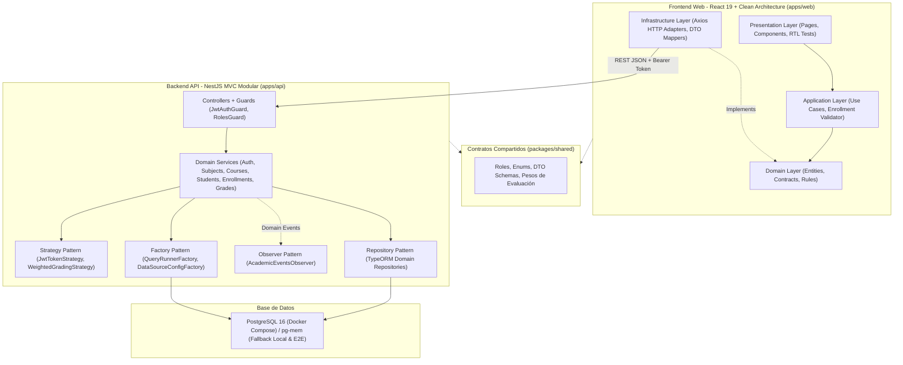

# Sistema Académico Institucional UNICEN 2026 (Monorepo)

Sistema académico integral con backend en **NestJS**, frontend en **React 19**, base de datos en **PostgreSQL**, orquestación en **Docker Compose** y sistema de diseño **Academic Precision**.

Desarrollado según las especificaciones técnicas de la **Universidad Central (UNICEN)**.

---

## 🏛️ Diagrama de Arquitectura



---

## 🧩 Decisiones de Arquitectura y Justificación de Patrones de Diseño

| Patrón / Arquitectura | Ubicación en el Código | Justificación y Problema que Resuelve |
| :--- | :--- | :--- |
| **Arquitectura por Capas & Clean Architecture por Features** | `apps/api/src/modules/*` y `apps/web/src/features/*/{domain,application,infrastructure,presentation}` | Desacopla las reglas de negocio académicas puras (cupos, choques de horarios, duplicidad, fórmulas de ponderación) de los detalles de infraestructura (HTTP, TypeORM, librerías de UI). |
| **Repository Pattern** | `apps/api/src/modules/*/*.repository.ts` y `apps/web/src/features/*/domain/*.repository.ts` | Centraliza el acceso y persistencia de datos. Permite desacoplar los servicios de TypeORM y de Axios, facilitando pruebas unitarias con mocks limpios. |
| **Strategy Pattern** | `apps/api/src/modules/auth/strategies/*` y `apps/api/src/modules/grades/strategies/*` | 1. **Autenticación Tokens:** `ITokenStrategy` (`JwtTokenStrategy` y extensible a PASETO v4).<br>2. **Ponderación Académica:** `IGradingStrategy` (`StandardUnicenGradingStrategy`) que calcula la nota sobre 100 (25% + 25% + 20% + 30%) y condición semántica (`APROBADO` $\ge 51$, `EN RIESGO`, `REPROBADO`). |
| **Factory Pattern** | `apps/api/src/database/query-runner.factory.ts` y `apps/api/src/database/data-source.factory.ts` | 1. **QueryRunnerFactory:** Encapsula el ciclo de vida de transacciones atómicas (`connect` + `startTransaction`) para el control de cupos simultáneos y permite testear determinísticamente el `rollbackTransaction`.<br>2. **DataSourceConfigFactory:** Abstrae la conexión a PostgreSQL real o en memoria (`pg-mem`) para ejecución sin dependencias externas. |
| **Observer Pattern** | `apps/api/src/modules/audit/observers/academic-events.observer.ts` | Escucha asíncronamente eventos de dominio (`enrollment.created`, `grade.updated`, `acta.closed`) mediante `@nestjs/event-emitter`, registrando bitácoras inmutables de auditoría y alertando cuando la ocupación de un curso supera el 95% (*Protocolo de Cupos Críticos*). |

---

## 🔑 Credenciales Semilla para Evaluación

| Rol | Correo Electrónico | Contraseña | Perfil / Cátedra |
| :--- | :--- | :--- | :--- |
| **ADMIN** | `coordinacion.acad@unicen.edu.bo` | `Unicen2026*` | Dra. Elena Valenzuela (Coord. Académica) |
| **DOCENTE** | `carlos.mendoza@unicen.edu.bo` | `Unicen2026*` | Dr. Carlos Mendoza S. (Estructuras de Datos SIS-301) |
| **DOCENTE** | `andrea.siles@unicen.edu.bo` | `Unicen2026*` | MSc. Andrea Siles Ramos (Paralelo B) |
| **DOCENTE** | `roberto.justiniano@unicen.edu.bo` | `Unicen2026*` | Ing. Roberto Justiniano (Bases de Datos SIS-305) |
| **ESTUDIANTE** | `mateo.morales@unicen.edu.bo` | `Unicen2026*` | Mateo Andrés Morales Soliz (`RU-2023-01984`) |
| **ESTUDIANTE** | `carlos.mendoza.est@unicen.edu.bo` | `Unicen2026*` | Carlos Ariel Mendoza Arce (`RU-2023-09418`) |
| **ESTUDIANTE** | `sofia.quispe@unicen.edu.bo` | `Unicen2026*` | Sofía Luciana Quispe Mamani (`RU-2023-11204`) |

*Nota: La pantalla de Login incluye botones de acceso rápido que autocompletan las credenciales de cada rol.*

---

## 🚀 Despliegue con Docker Compose (Entregable Requerido)

Levanta la base de datos PostgreSQL 16, la API de NestJS y la aplicación web compilada servida por Nginx:

```bash
docker compose up --build
```

- **Cliente Web:** [http://localhost:8080](http://localhost:8080)
- **API Backend:** [http://localhost:3000/api](http://localhost:3000/api)
- **Base de Datos PostgreSQL:** Puerto `5432` (`unicen_academico`)

---

## 💻 Desarrollo Local (Sin necesidad de Docker)

El monorepo cuenta con un motor PostgreSQL en memoria (`pg-mem`) integrado por defecto si no detecta PostgreSQL corriendo en `localhost:5432`.

### 1. Instalación de dependencias
```bash
npm install
```

### 2. Ejecutar en paralelo API y Web
```bash
npm run dev
```
- **Web (Vite Dev Server):** [http://localhost:5173](http://localhost:5173)
- **API (NestJS):** [http://localhost:3000/api](http://localhost:3000/api)

---

## 🧪 Ejecución de Pruebas Automatizadas (Suites Obligatorias)

### Pruebas Unitarias del Backend (Jest)
Valida los 4 casos críticos de `EnrollmentsService` (cupo disponible, duplicidad, cupo agotado y rollback de transacciones) y la seguridad de `RolesGuard`:
```bash
npm run test --workspace=@unicen/api
```

### Prueba E2E del Backend (Supertest)
Ejecuta el flujo completo de Login con usuario semilla $\rightarrow$ obtención de Bearer token $\rightarrow$ `POST /enrollments` (HTTP 201) $\rightarrow$ reintento idéntico (HTTP 409 Conflict):
```bash
npm run test:e2e --workspace=@unicen/api
```

### Pruebas Unitarias e Integración del Frontend (Vitest + RTL)
Valida la función de dominio `validateEnrollmentSelection` (cupos $\le 0$, duplicidad, colisión de horarios), el formulario de login y que el input de calificaciones sea editable únicamente por `DOCENTE` y `ADMIN`:
```bash
npm run test --workspace=@unicen/web
```

### Ejecución Global desde la Raíz
```bash
npm run test
npm run test:e2e
```

---

## 🎨 Identidad Visual "Academic Precision"
- **Tipografías:** `Hanken Grotesk` (Títulos y métricas numéricas con tracking negativo) y `Geist` (Cuerpo, tablas y cifras tabulares con `tabular-nums`).
- **Paleta Institucional:** Pizarra Pizarra `#0f172a`, Azul Marino Académico `#1e3a8a`, Acento `#2563eb`, Superficie `#f8fafc`, Bordes nítidos de 1px `#e2e8f0` / `#cbd5e1`.
- **Bordes y Radio:** Esquinas suavemente redondeadas (`rounded-md` / `rounded-lg`) que equilibran la ergonomía moderna de las capturas con el rigor de un sistema institucional.
